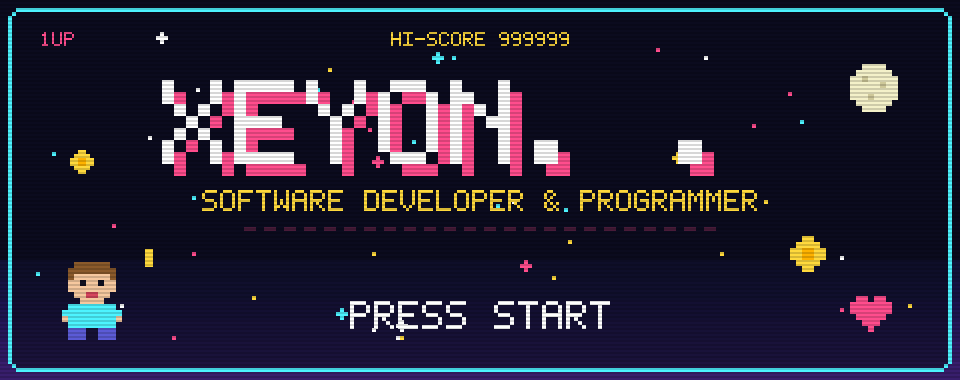
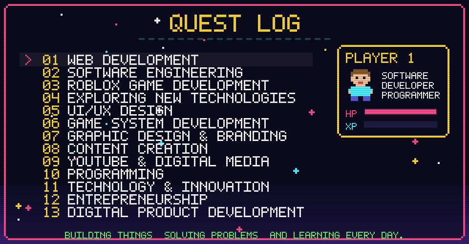
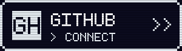
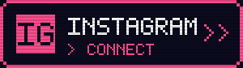
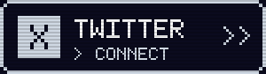
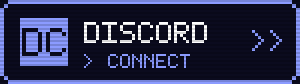
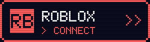
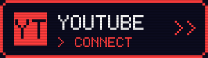
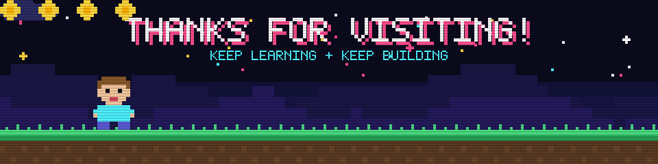

<!-- ============================================================
     PIXEL PROFILE README - YONXE (FIXED ALL)
     ============================================================ -->

<!-- ==================== HEADER ==================== -->

  

<!-- ==================== TYPING ==================== -->

  

<!-- ==================== ABOUT ==================== -->

  

<!-- ==================== SKILLS ==================== -->

  

<!-- ==================== STATS + STREAK ==================== -->
<!-- Server alternatif (shion.dev) biar ga patah -->

  
  

<!-- ==================== SOCIAL BUTTONS ==================== -->

  
  
  
  
  
  
  
  

<!-- ==================== VIEWS & BADGES ==================== -->

  
  
  

<!-- ==================== FOOTER ==================== -->

  

